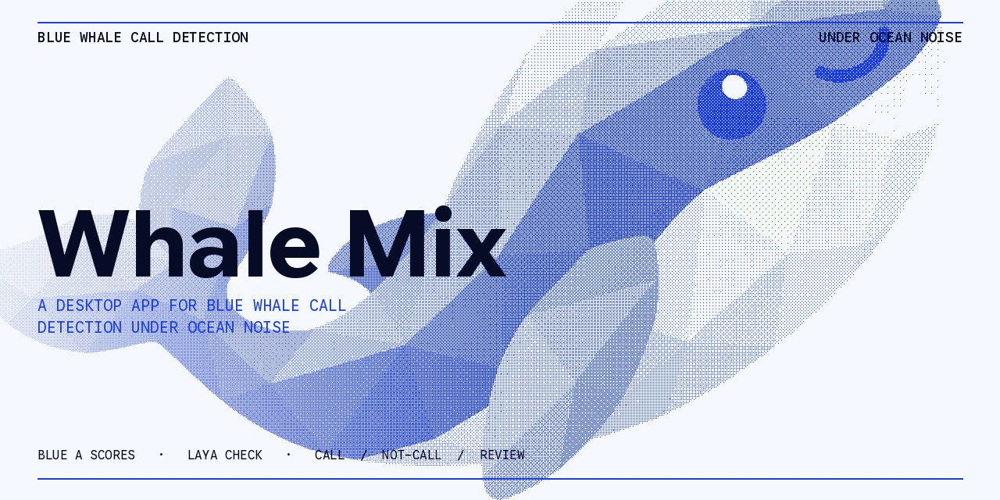
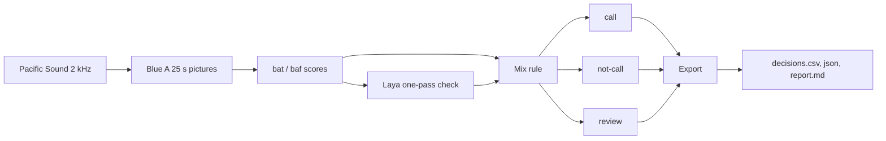
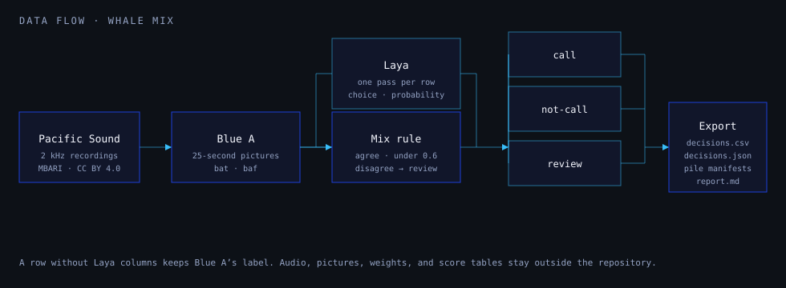
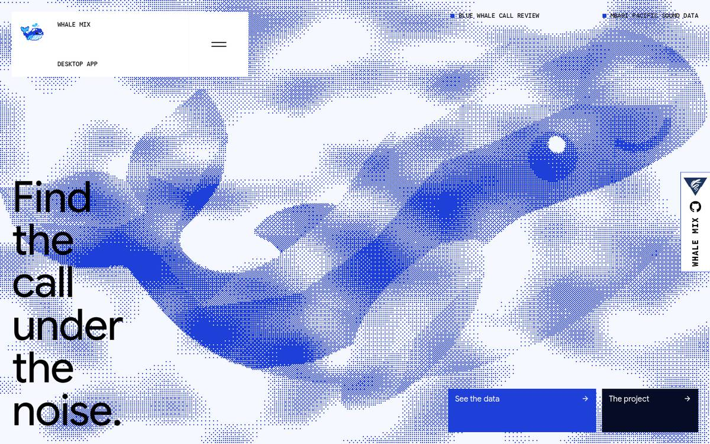
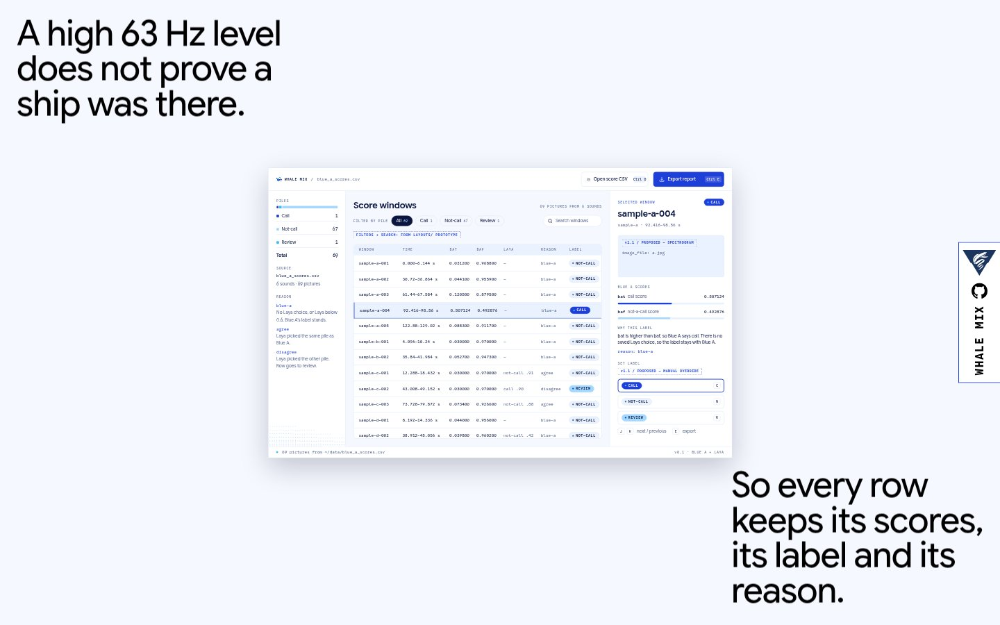
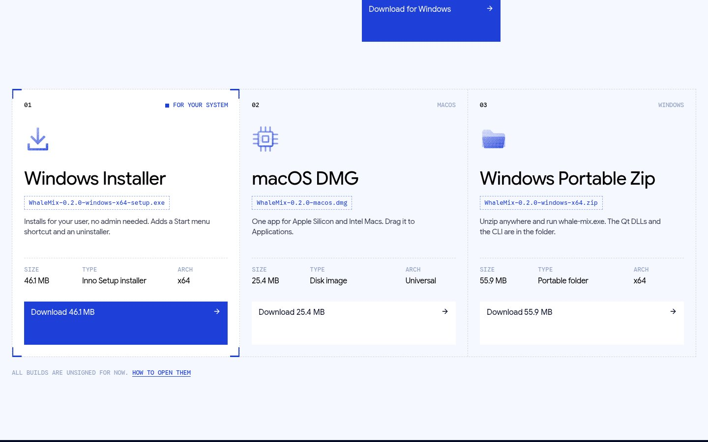
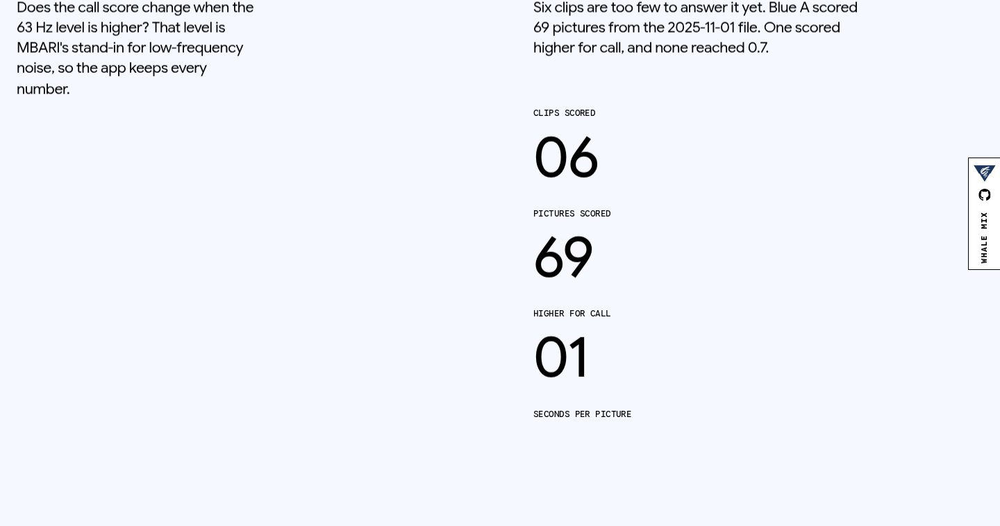
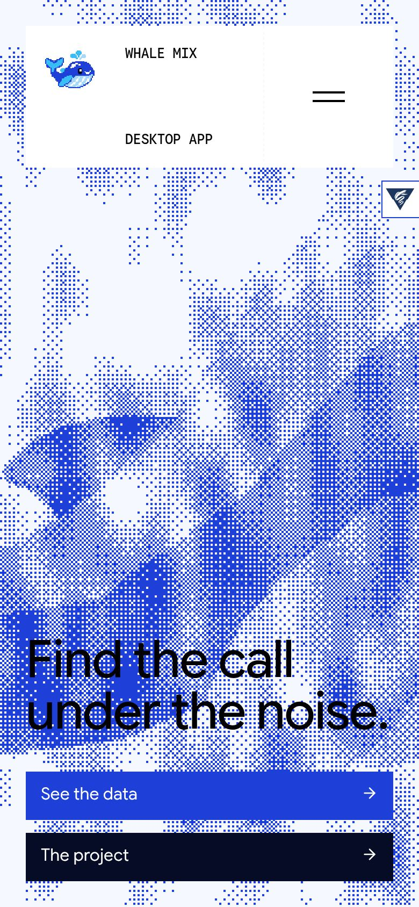

# Whale Mix

**Find the call under the noise.** Whale Mix is a desktop app, and an independent student project, for blue whale call detection under ocean noise. It reads MBARI Blue A scores for 25-second pictures, takes Laya's one-pass second opinion, and sorts each row into `call`, `not-call`, or `review`.

It is not an official MBARI project or endorsement.

[Live site](https://blue-whale-call-detection-under-oce.vercel.app) · [Source](https://github.com/acheronx0577/whale-mix) · [Desktop App](https://blue-whale-call-detection-under-oce.vercel.app/desktop)

   

## What's new

The README on `main` still opens as a lab note: the question, the mix rule, the Python commands, and the 2026-10-13 score record. Since then the project has shipped a public site and a packaged desktop app, all present on `main`:

- **Site.** A Next.js 16 marketing site at [blue-whale-call-detection-under-oce.vercel.app](https://blue-whale-call-detection-under-oce.vercel.app), with an interactive Whale Mix window on Home, pages for How it Works, About the Project, Data & Credits, Notes, and Get the Code, and a right-edge badge that links to this repository.
- **Desktop App page.** [`/desktop`](https://blue-whale-call-detection-under-oce.vercel.app/desktop) lists the v0.2.0 packages, first-launch steps, and a live demo of the window.
- **C++ desktop app, v0.2.0.** Whale Mix is a C++20 / Qt 6 app: a Windows installer, a portable zip, a universal macOS disk image, and standalone `whale-mix.exe` and `whale-mix-cli.exe` builds. The builds are unsigned. A row that already contains `laya_choice` and `laya_probability` uses the mix rule; a row without those columns keeps Blue A's label.
- **Headless CLI.** `whale-mix-cli --scores path/to/candidate-scores.csv --out out/mix` writes the same export without a window.

## Method

The question the project is recording toward is: does the call score change when the 63 Hz level is higher? That level is MBARI's stand-in for low-frequency noise. A whale-call harmonic or the recorder can raise it, so a high number does not by itself prove a ship was present.

Blue A reads a 25-second picture from an original 2 kHz recording and returns two scores. `bat` is the call score. `baf` is the not-a-call score. The bigger score is Blue A's label for that picture. Ties go to `not-call`.

Laya is a second opinion. It reads the written row and answers in one pass, with a choice and the probability it gave that choice. After the rows are sorted, Laya can also read the counts once; that reading is written under the counts in `report.md`. The mix keeps both answers (`whale_mix/mix.py` and `app/core/src/rules.cpp`):

- When they agree, the row keeps that label (`agree`).
- When Laya's choice probability is under 0.6, or Laya is missing, Blue A's label stays (`blue-a`).
- When they disagree and Laya is confident, the row goes to `review` (`disagree`). Both scores stay on the row.

The export then writes three piles — `call`, `not-call`, and `review` — each with a manifest, plus `decisions.csv`, `decisions.json`, and `report.md`.

Recordings come from the Pacific Sound archive. The picture step and the starting weights are MBARI's Blue A model. The one-pass check is Laya. Audio, pictures, score tables, Blue A weights, and Laya weights stay outside this repository.

## Data flow



<p align="center">
  
</p>

*Pacific Sound recordings go to Blue A as 25-second pictures. Blue A writes `bat` and `baf`. Laya, when a choice is present, is a one-pass check on each written row. The mix rule fills the piles. A row without Laya columns keeps Blue A's label.*

## Figures

**Figure 1.** Home. The faceted whale hero, and the line the project is built around.

<p align="center">
  
</p>

**Figure 2.** The interactive app demo on Home. Open a Blue A score CSV, inspect a window, and export the piles. This is the site demo, not a results chart.

<p align="center">
  
</p>

**Figure 3.** Desktop App at `/desktop`. The three v0.2.0 packages: Windows installer, universal macOS disk image, and Windows portable zip. Builds are unsigned.

<p align="center">
  
</p>

**Figure 4.** How it Works. The recorded counts from the first six clips: 69 pictures, one scored higher for call, none reached 0.7.

<p align="center">
  
</p>

**Figure 5.** Home on a phone.

<p align="center">
  
</p>

## Downloads

Whale Mix 0.2.0, published on the [v0.2.0 GitHub Release](https://github.com/acheronx0577/whale-mix/releases/tag/v0.2.0). The builds are unsigned. The Windows installer does not need admin rights. On first launch, Windows SmartScreen or macOS Gatekeeper will ask once; the Desktop App page has the steps. The app opens at 1440 × 900, with a minimum size of 1200 × 760. macOS builds target macOS 12 or later and are universal (Apple Silicon and Intel).

Sizes below are the published asset sizes on that release, rounded from the asset byte counts in decimal units (1 MB = 1,000,000 bytes, 1 KB = 1,000 bytes).

| Package | File | Size | Notes |
|---|---|---|---|
| Windows installer | [WhaleMix-0.2.0-windows-x64-setup.exe](https://github.com/acheronx0577/whale-mix/releases/download/v0.2.0/WhaleMix-0.2.0-windows-x64-setup.exe) | 46.5 MB | Inno Setup, x64 |
| Windows portable zip | [WhaleMix-0.2.0-windows-x64.zip](https://github.com/acheronx0577/whale-mix/releases/download/v0.2.0/WhaleMix-0.2.0-windows-x64.zip) | 55.5 MB | Unzip and run `whale-mix.exe`. Qt DLLs and the CLI are in the folder. |
| macOS disk image | [WhaleMix-0.2.0-macos.dmg](https://github.com/acheronx0577/whale-mix/releases/download/v0.2.0/WhaleMix-0.2.0-macos.dmg) | 25.4 MB | Universal. Drag to Applications, then right-click and Open the first time. |
| Windows GUI exe | [whale-mix.exe](https://github.com/acheronx0577/whale-mix/releases/download/v0.2.0/whale-mix.exe) | 1.8 MB | The desktop app binary alone, as extracted from the zip. Needs the Qt DLLs beside it. |
| Windows CLI exe | [whale-mix-cli.exe](https://github.com/acheronx0577/whale-mix/releases/download/v0.2.0/whale-mix-cli.exe) | 135 KB | Headless export. No window. |

The live download page is [`/desktop`](https://blue-whale-call-detection-under-oce.vercel.app/desktop).

## Results

Recorded 2026-10-13. Six five-minute clips from the 2025-11-01 Pacific Sound file, Samples A through F. Blue A scored 69 pictures on the original files. One picture scored higher for `bat`: Sample A, 92.4–98.6 seconds, `bat` 0.507 and `baf` 0.493. The other 68 scored higher for `baf`. None reached 0.7.

| Sample | Pictures | Bigger `bat` | Highest `bat` |
| --- | --- | --- | --- |
| A | 7 | 1 | 0.507 |
| B | 9 | 0 | 0.030 |
| C | 6 | 0 | 0.073 |
| D | 20 | 0 | 0.044 |
| E | 22 | 0 | 0.034 |
| F | 5 | 0 | 0.041 |

Calibrated 63 Hz medians for the first four clips, dB re 1 μPa²/Hz: A 70.622, C 71.485, B 76.229, D 77.448. The call score stays near 0.03 in both the quieter pair and the noisier pair.

The original files are too quiet for a human ear. Louder copies are for listening only. Ear labels written earlier are the weak part of the record, so this set does not support a miss rate, a false-alarm rate, or a noise comparison. The six clips are too few to answer the question.

A one-row run of `whale_mix` on the Sample A picture above returned Laya choice `call` at probability 0.743. The mix label was `call`, reason `agree`.

MBARI's published blueA validation F1 is 0.9454 for candidate pictures. That number is MBARI's, measured on their validation set. It is not a result from this project.

## Stack

| Layer | Technology |
|---|---|
| Desktop app | C++20, Qt 6 (6.8.3 in CI; CMake requires 6.5+), CMake 3.25; optimized zero-allocation table scroll, D3D GPU texture blitting, O(1) font cache |
| Headless CLI | `whale-mix-cli`, same mix and export rules as the window |
| Python pipeline | `python -m whale_mix` (stdlib for the mix; the `laya` package for the check; OpenCV, NumPy, and TensorFlow for `score --image`) |
| Site | Next.js 16.3.6 (Turbopack), React 19.2.8, GSAP 3.15.0, Lenis 1.3.8, three.js 0.186.0, @unlocalhosted/dither-icons 0.2.5 |
| Web Quality & SEO | Lighthouse 100/100 Accessibility, 100/100 Best Practices, 100/100 SEO, 97/100 Desktop Performance; dynamic `sitemap.xml`, `robots.txt`, Schema.org JSON-LD structured data |
| Favicon Suite | Google Search-compliant 48×48 PNG, multi-resolution 16/32/48 ICO, 180×180 Apple Touch Icon, 192/512 PWA icons |
| Fonts | Google Sans Flex and Google Sans Code (OFL 1.1) |
| Packaging | Inno Setup (Windows), universal macOS .dmg (arm64 and x86_64) |
| Quality | `unittest` for the Python mix, CTest / GoogleTest / Qt Test for the desktop app (0.10s GUI test runtime, 0.59s total suite), GitHub Actions `desktop` workflow |

## Quick start

```sh
git clone https://github.com/acheronx0577/whale-mix.git
cd Blue-Whale-Call-Detection-Under-Ocean-Noise
```

To run the packaged app, download a v0.2.0 build from the table above, or from [`/desktop`](https://blue-whale-call-detection-under-oce.vercel.app/desktop).

The Python mix, from the repo root, scores, sorts, and exports in one command. Blue A weights and Laya weights stay outside this repository, so `sort` and `run` need a local Laya checkpoint.

```sh
python -m whale_mix run --scores path/to/candidate-scores.csv --out out/mix
```

To run the site locally, `cd site`, then `npm install` and `npm run dev`. Open [http://localhost:3000](http://localhost:3000).

<details>
<summary>CLI usage, tests, data, and environment</summary>

Each Python step also runs alone:

```sh
python -m whale_mix score --scores path/to/candidate-scores.csv --out out/sound.csv
python -m whale_mix sort --table out/sound.csv --out out/sorted.csv
python -m whale_mix export --table out/sorted.csv --out out/mix
python -m whale_mix analyze --table out/mix/decisions.csv --out out/mix
```

`score --image picture.jpg` scores one spectrogram with the local Blue A weights. The export writes the technical files first: `decisions.csv`, `decisions.json`, and `call`, `not-call`, and `review` folders. `report.md` is written after those files. An optional `--noise` CSV with `sample_id` and `noise_db` attaches a 63 Hz level to each sample in that report.

Headless desktop export:

```sh
whale-mix-cli --scores path/to/candidate-scores.csv --out out/mix [--noise path/to/noise.csv]
```

Input CSV columns. Required: `timestamp` (or `start_time` / `time`), `bat`, `baf`. Optional: `sample_id`, `laya_choice`, `laya_probability` (or `laya_prob`), `image_file`, `duration_s`.

Build the desktop app from source (Windows example). Visual Studio 2022 with the Desktop development with C++ workload, and Qt 6.8.3 with `qtimageformats`:

```powershell
cmake --preset windows-msvc
cmake --build --preset windows-msvc-release
ctest --preset windows-msvc-release
```

The Windows binary lands at `build/windows-msvc/app/Release/whale-mix.exe`. On macOS, `cmake --preset macos`, then `cmake --build --preset macos-release`. The deployment target is macOS 12.0.

Python mix tests, from the repo root:

```sh
python -m unittest tests.test_mix
```

Environment variables used by the Python CLI, all optional overrides for local model paths: `WHALE_LAYA`, `WHALE_BLUE_A_MODEL`, `WHALE_BLUE_A_PYTHON`. None of those weights are in this repository. `score --image` needs a Python that has TensorFlow, OpenCV, and NumPy.

Keyboard shortcuts in the desktop app: `Ctrl/Cmd O` opens a score CSV, `Ctrl/Cmd E` exports, `Ctrl/Cmd F` focuses search, `J` / `K` move the row, `C` / `N` / `R` override the selected row to call, not-call, or review, `Ctrl/Cmd Z` undoes the last override.

</details>

## Credits

An independent student project. Not an official MBARI project or endorsement.

- The [Pacific Sound archive](https://www.mbari.org/project/open-acoustic-data/) provides daily 2 kHz recordings. The [AWS Open Data registry](https://registry.opendata.aws/pacific-sound/) lists the recordings and `s3://pacific-sound-models` under **CC BY 4.0**. Attribute Monterey Bay Aquarium Research Institute, link the registry and the [model page](https://docs.mbari.org/pacific-sound/models/), and note changes. The full text is in [LICENSE-CC-BY-4.0](LICENSE-CC-BY-4.0).
- The picture step and the starting weights are MBARI's [Blue A](https://docs.mbari.org/pacific-sound/notebooks/bluewhales/classify/blueA/PacificSoundClassifyBlueA/) model.
- The interactive website template, motion layout, and canvas dither shader concept are adapted from [Codegrid](https://www.youtube.com/@codegrid).
- Laya's English checkpoint is Apache-2.0: [convaiinnovations/laya](https://huggingface.co/convaiinnovations/laya). This repository does not include those weights.
- Qt 6 is used under LGPLv3 (dynamic linking). Google Sans Flex and Google Sans Code are under the SIL Open Font License 1.1.
- Original code in this repository is under the MIT license in [LICENSE](LICENSE). That license does not replace the CC BY 4.0 terms for MBARI material or the Apache-2.0 terms for Laya.
- MBARI's [shipping-noise notebook](https://docs.mbari.org/pacific-sound/notebooks/shippingnoise/PacificSoundShippingNoiseAnalysis/) is GPL-3.0. This repository does not include that notebook.

Sources: [Pacific Sound quickstart](https://docs.mbari.org/pacific-sound/quickstart/), [data registry](https://registry.opendata.aws/pacific-sound/), [Blue A model page](https://docs.mbari.org/pacific-sound/models/), [Laya checkpoint](https://huggingface.co/convaiinnovations/laya).

Inquiries go through [Get the Code](https://blue-whale-call-detection-under-oce.vercel.app/contact) or the GitHub repository.
